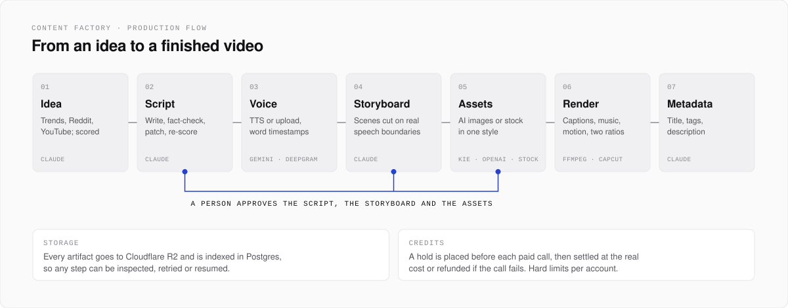
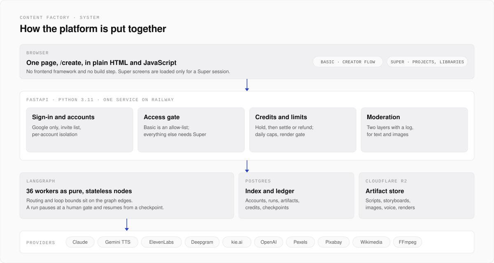

# Content Factory

[](https://github.com/gobokobok/content-factory-saas/actions/workflows/ci.yml)
[](https://www.python.org/downloads/release/python-3110/)
[](https://fastapi.tiangolo.com/)
[](https://langchain-ai.github.io/langgraph/)

**A platform that turns an idea into a finished video.** It finds topics, writes and fact-checks the script, generates the voiceover, plans every scene against word-level timestamps, gets AI images or stock footage for each scene, and renders the video with captions and music. A person approves each editorial decision on the way.

It started as the pipeline behind a data-driven YouTube Shorts channel. It is now a multi-user product with Google sign-in, per-account isolation, prepaid credits and hard spend limits.

**Live:** [cf.graholskis.com](https://cf.graholskis.com) (invite-only beta; the sign-in page has a link to ask for demo access).

## Contents

- [What it does](#what-it-does)
- [The product](#the-product)
- [Architecture](#architecture)
- [Accounts, credits and safety](#accounts-credits-and-safety)
- [Stack](#stack)
- [Repository layout](#repository-layout)
- [Running locally](#running-locally)
- [Deployment](#deployment)
- [How this was built](#how-this-was-built)
- [Status](#status)

## What it does



| Step | What happens | Services |
|------|--------------|----------|
| 1. Idea | Topics are collected from Reddit, Google Trends and YouTube, scored, and kept in a shortlist per project. | Claude |
| 2. Script | The script is written, fact-checked, patched and re-scored in a bounded loop. It can also be pasted, or taken from an uploaded voiceover. | Claude |
| 3. Voice | Text-to-speech in a named voice, or an uploaded recording. The audio is transcribed to word-level timestamps and checked for language and missing narration. | Gemini TTS, ElevenLabs, Deepgram |
| 4. Storyboard | Scenes are planned against the timestamps, so cuts land on real speech boundaries. Scenes can be split, merged and edited. | Claude |
| 5. Assets | Each scene gets an AI image in one master style with a reusable cast, or stock footage with semantic re-ranking. A failed scene degrades; it does not fail the run. | kie.ai, OpenAI, Pexels, Pixabay, Wikimedia |
| 6. Render | Captions timed to speech, music, motion and colour grade, in 9:16 or 16:9. A second path exports a CapCut project for manual finishing. | FFmpeg |
| 7. Metadata | A title, description, tags and pinned comment are drafted from the final script. | Claude |

Every artifact (script, storyboard, asset manifest, render) is stored in Cloudflare R2 and indexed in Postgres, so any step can be inspected, retried or resumed. Each execution records the worker version, prompt version, model and sampling parameters.

## The product

The whole application is one page, `/create`. What an account sees depends on its type.

| Account | What it gets |
|---------|--------------|
| **Basic** | The Creator flow: write a story, pick a voice and characters, see the cost in credits, get a video. Libraries for its own videos, AI generations and background music. |
| **Super** | Everything in Basic, plus projects with an idea shortlist, the three script sources, voiceover upload with transcript editing, storyboard controls, stock acquisition, sound effects, the Metadata step, CapCut export, all five libraries, integrations and defaults. |

Super screens are a separate script that a Basic session never downloads.

**New video.** Topic, format, look, language, a master visual style and the cast are fixed before anything is generated, because every later step depends on them.


**Storyboard.** One row per scene: its time range from the voiceover, the words spoken, the characters and places in it, the camera motion and the generated image. Scenes can be merged, split and edited.


**Render.** Captions and background music are chosen here; the finished video plays in the page and can be downloaded.


## Architecture



- **Workers are pure functions.** Each of the 36 worker modules is a stateless LangGraph node: typed state in, typed output out, exactly one artifact per execution. Routing and loop bounds sit on the graph edges, never inside a worker.
- **State is a message bus, not a data store.** Graph state carries artifact references and a typed control signal. The durable truth is the artifact in R2, indexed in Postgres.
- **Human gates.** A run pauses at an editorial checkpoint and resumes from the Postgres checkpointer when the person decides.
- **Thin routes.** Pipeline steps are pure async functions with explicit inputs and outputs, so they run without an HTTP request.
- **One timeline, two render paths.** Scene timing is resolved in one place and feeds both the FFmpeg render and the CapCut export.

More detail: [docs/ARCHITECTURE.md](docs/ARCHITECTURE.md) and [docs/v2_platform_plan.md](docs/v2_platform_plan.md).

## Accounts, credits and safety

- **Sign-in.** Google is the only way in. The owner manages an invite list; removing an address switches the account off.
- **Isolation.** Every row and every stored file belongs to one account. Provider keys saved by a user are encrypted.
- **Access.** A Basic account may call only the routes on an allow-list. Everything else requires Super, checked on the server.
- **Credits.** One credit is one cent of provider cost. A hold is placed before each paid call, settled at the real cost afterwards, and refunded in full if the call fails. A hold that does not fit the balance is refused before anything starts.
- **Limits.** Per-account caps on script length, runs per day, daily spend, storage and concurrent renders, plus one render gate for the whole server.
- **Moderation.** Two layers with a log, for text and images.
- **Operations.** Start-up refuses weak secrets, logs redact signed URLs and tokens, the container runs as a non-root user on a pinned base image, and there is a written backup, restore and account-erasure procedure.

See [docs/SECURITY.md](docs/SECURITY.md) and [docs/RUNBOOK.md](docs/RUNBOOK.md).

## Stack

| Layer | Choice |
|-------|--------|
| Backend | Python 3.11, FastAPI, Pydantic v2 |
| Orchestration | LangGraph with a Postgres checkpointer |
| Data | PostgreSQL (psycopg), Cloudflare R2 (S3 API) |
| Language models | Claude API |
| Voice | Gemini TTS, ElevenLabs, Deepgram (word-level alignment) |
| Images and footage | kie.ai, OpenAI, Replicate, Pexels, Pixabay, Wikimedia, sentence-transformers for re-ranking |
| Video | FFmpeg, CapCut project export |
| Auth | Google OAuth |
| Frontend | Plain HTML and JavaScript, no framework and no build step |
| Delivery | Docker, Railway, GitHub Actions, pytest |

## Repository layout

| Path | What it is |
|------|------------|
| `cf_platform/` | The platform: LangGraph workers, stage graphs, accounts, billing, limits, moderation, Postgres repositories and migrations, API routes |
| `src/` | The FastAPI app, sign-in, the pages in `src/static/`, and the original video pipeline (asset acquisition, captions, FFmpeg), reached from the platform only through `cf_platform/adapters/legacy_video.py` |
| `tests/` | About 3,400 automated tests in 154 files, run in CI on every push |
| `docs/` | Architecture, security, runbook, prompt log, testing strategy, UI guidelines |
| `scripts/` | Bootstrap, release, cost report, account erasure |
| `tools/` | Standalone browser tools and the CapCut helper |

The two-package layout is deliberate. The first pipeline kept running while the platform replaced it one stage at a time (the strangler-fig pattern).

## Running locally

```bash
bash scripts/bootstrap.sh          # venv, dependencies, .env.local template
source .venv/bin/activate
# fill in .env.local; ENV.md lists every variable
uvicorn src.main:app --reload
```

Health check: `curl http://localhost:8000/health`. The app is at `http://localhost:8000/create`.

It needs API keys for the providers you use and Cloudflare R2 credentials. A Postgres `DATABASE_URL` turns on accounts, projects and billing. `scripts/preview_core.py` serves the screens with in-memory storage, to look at them without any credentials.

## Deployment

| Environment | Railway service | How it deploys |
|-------------|-----------------|----------------|
| DEV | `content-factory-dev` | Every push to `main` |
| PROD | `content-factory-saas` | A release tag `v*.*.*`, through GitHub Actions, with a `/health` check after the deploy |

Migrations run at start-up under a lock, and `/health` reports their state. Releases are listed in [RELEASES.md](RELEASES.md).

## How this was built

I built this solo with AI-assisted tooling, under a written process. Every architectural choice is recorded before the code.

- [DECISIONS.md](DECISIONS.md): 122 numbered architecture and dependency decisions, including reversals and the reason for them
- [METHODOLOGY.md](METHODOLOGY.md): the sprint workflow, the definition of done, and the rule that every sprint ends with something a person can use
- [CONVENTIONS.md](CONVENTIONS.md): the Python standards (pure async step functions, thin routes, typed contracts)
- [docs/PROMPTS.md](docs/PROMPTS.md): the prompt log, where each revision is tied to a failure I observed
- [docs/TESTING.md](docs/TESTING.md): the test strategy for each layer

## Status

An invite-only beta is live. Credits are on, at cost, with no payment provider yet. Next on the roadmap: platform settings and measurement, then payments and self-service data export and deletion, then character references, load testing before open sign-up, and a Russian-language version. The full plan is in [SPRINT.md](SPRINT.md).
